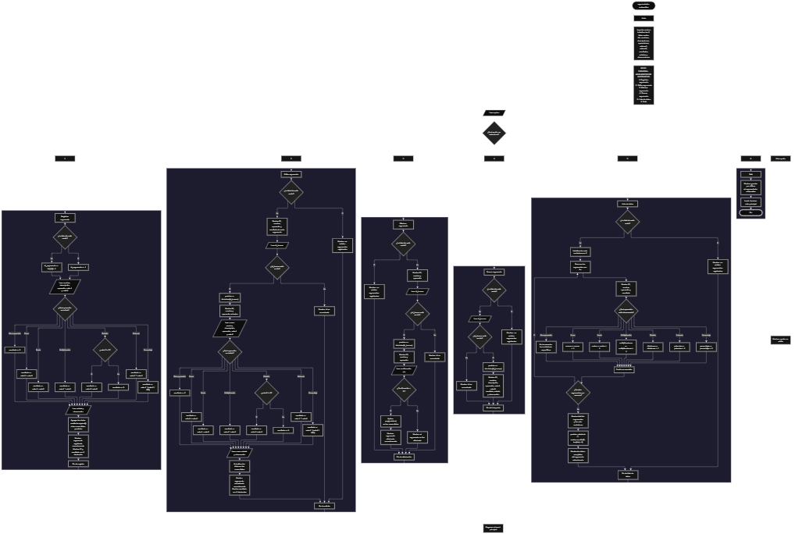

Este proyecto, llamado <b>argumentador matemático</b>, fue desarrollado en <b>python</b> como un ejercicio práctico para fortalecer la lógica de programación mediante la creación de un sistema de gestión de operaciones matemáticas desde la consola. El programa cuenta con un menú principal de seis opciones que permite <b>registrar, editar, eliminar, buscar, listar y consultar información de los argumentos matemáticos</b>. Cada argumento almacena datos como el nombre del cálculo, la descripción, el tipo de operación, los valores utilizados, el resultado obtenido, el estado y las observaciones, utilizando nueve listas relacionadas para organizar la información durante la ejecución. Durante su desarrollo se aplicaron conceptos fundamentales de programación, como variables, listas, estructuras condicionales, ciclos repetitivos, operaciones aritméticas, búsqueda por identificador, modificación y eliminación de registros, además de la generación de estadísticas y la selección aleatoria de un argumento. Este proyecto permite poner en práctica los conocimientos adquiridos en python y sirve como base para desarrollar sistemas matemáticos y aplicaciones de gestión más avanzadas.

<h2 align="center">⚙️ Funcionamiento del menú principal</h2>

### ➕ Registrar argumento

La opción <b>1) registrar argumento</b> permite registrar una nueva operación matemática. Antes de realizar el registro, el programa comprueba si la lista <b>ids</b> está vacía mediante la condición <b>len(ids) == 0</b>. Si no existen argumentos registrados, asigna el identificador <b>1</b> al nuevo registro. En caso contrario, genera el siguiente identificador sumando uno al último valor almacenado en la lista <b>ids</b>, mediante la expresión <b>ids[-1] + 1</b>. Después, solicita el <b>nombre del cálculo, la descripción, el tipo de operación, el primer valor y el segundo valor</b>. El tipo de operación se convierte a minúsculas y se utiliza para determinar el cálculo que debe realizarse. El programa admite las operaciones <b>suma, resta, multiplicación, división, potencia y porcentaje</b>. En la división, comprueba si el segundo valor es diferente de cero; si es cero, asigna el resultado <b>0</b>. Si la operación introducida no coincide con ninguna de las operaciones reconocidas, también asigna el resultado <b>0</b>. Finalmente, solicita el estado y la observación, almacena todos los datos en sus respectivas listas y muestra el mensaje <b>"argumento registrado correctamente."</b>, junto con el identificador y el resultado calculado con dos decimales.

### ✏️ Editar argumento

La opción <b>2) editar argumento</b> permite modificar la información de un argumento matemático registrado. Primero, el programa comprueba si existen registros mediante la lista <b>ids</b>. Si está vacía, muestra el mensaje <b>"no existen argumentos registrados."</b>. En caso contrario, presenta una lista con el identificador, el nombre, la operación y el resultado de cada argumento. Después, solicita el identificador que se desea editar y lo busca dentro de la lista <b>ids</b>. Si encuentra una coincidencia, utiliza el método <b>ids.index(id_buscar)</b> para obtener la posición del registro correspondiente. A continuación, muestra algunos datos actuales y solicita el nuevo nombre, la descripción, el tipo de operación, los dos valores numéricos, el estado y la observación. Con la nueva información, vuelve a calcular el resultado utilizando las mismas operaciones disponibles durante el registro. Si el segundo valor de una división es cero o la operación no es reconocida, asigna el resultado <b>0</b>. Finalmente, actualiza los datos en las listas correspondientes y muestra el mensaje <b>"argumento actualizado correctamente."</b>, junto con el resultado actualizado. Si el identificador no existe, presenta el mensaje <b>"id no encontrada."</b>.

### 🗑️ Eliminar argumento

La opción <b>3) eliminar argumento</b> permite eliminar un argumento matemático mediante su identificador. Antes de comenzar, el programa comprueba si existen registros en la lista <b>ids</b>. Si no hay argumentos almacenados, muestra el mensaje <b>"no existen argumentos registrados."</b>. Si existen registros, presenta una lista con el identificador, el nombre y el tipo de operación de cada argumento. Después, solicita el identificador que se desea eliminar y comprueba si se encuentra en la lista <b>ids</b>. Si lo encuentra, utiliza <b>ids.index(id_buscar)</b> para determinar la posición del argumento, muestra algunos de sus datos y solicita confirmación mediante la pregunta <b>"¿desea eliminar este argumento? (s/n): "</b>. Si el usuario introduce <b>"s"</b>, independientemente de si utiliza mayúsculas o minúsculas, el programa elimina el registro utilizando el método <b>pop(posicion)</b> en las nueve listas: <b>ids, nombres, descripciones, operaciones, valores1, valores2, resultados, estados y observaciones</b>. Finalmente, muestra el mensaje <b>"argumento eliminado correctamente."</b>. Si el usuario no confirma la eliminación, presenta el mensaje <b>"el argumento no fue eliminado."</b>. Si el identificador no existe, muestra el mensaje <b>"id no encontrada."</b>.

### 🔎 Buscar argumento

La opción <b>4) buscar argumento</b> permite localizar y consultar un argumento matemático mediante su identificador. Primero, el programa comprueba si existen argumentos registrados. Si la lista <b>ids</b> está vacía, muestra el mensaje <b>"no existen argumentos registrados."</b>. En caso contrario, solicita el identificador que se desea buscar y comprueba si está almacenado en la lista. Cuando encuentra una coincidencia, obtiene la posición mediante <b>ids.index(id_buscar)</b> y muestra la información completa del argumento: <b>identificador, nombre, descripción, operación, primer valor, segundo valor, resultado, estado y observación</b>. El resultado se presenta con dos decimales utilizando <b>format(resultados[posicion], ".2f")</b>. Si el identificador introducido no se encuentra en la lista, el programa muestra el mensaje <b>"id no encontrada."</b>. Esta función facilita la consulta individual de los argumentos sin necesidad de recorrer manualmente todos los registros.

### 📋 Lista de datos

La opción <b>5) lista de datos</b> permite visualizar los argumentos matemáticos registrados y consultar las estadísticas de las operaciones realizadas. Antes de mostrar los datos, el programa comprueba si existen registros en la lista <b>ids</b>. Si está vacía, presenta el mensaje <b>"no existen argumentos registrados."</b>. Si hay argumentos disponibles, inicializa seis contadores: <b>sumas, restas, multiplicaciones, divisiones, potencias y porcentajes</b>. Después, utiliza un ciclo <b>for</b> para recorrer los registros y mostrar el identificador, el nombre, el tipo de operación y el resultado de cada argumento. Durante el recorrido, incrementa el contador correspondiente cuando el contenido de la lista <b>operaciones</b> coincide exactamente con uno de los seis tipos reconocidos. Al finalizar, muestra el total de argumentos registrados mediante <b>len(ids)</b> y presenta la cantidad contabilizada para cada operación. Finalmente, selecciona una posición aleatoria mediante <b>random.randint(0, len(ids) - 1)</b> y muestra la información completa del argumento elegido, incluyendo sus valores, el resultado, el estado y la observación. De esta manera, la opción combina la consulta general de los registros con un resumen estadístico y una selección aleatoria.

### 🚪 Salir del menú principal

La opción <b>6) salir</b> permite finalizar la ejecución del programa. Cuando el usuario selecciona esta opción, el sistema muestra el mensaje <b>"gracias por utilizar el argumentador matematico."</b> y ejecuta la instrucción <b>break</b>, que interrumpe el ciclo <b>while True</b> y termina el menú principal. Como los datos se almacenan únicamente en listas durante la ejecución, la información registrada se pierde al cerrar el programa. Para conservar los argumentos entre distintas ejecuciones, sería necesario implementar posteriormente algún mecanismo de almacenamiento permanente, como archivos o una base de datos.

<h2 align="center">🧠 Temas aplicados en el proyecto</h2>

### 📦 Variables

En este proyecto se utilizan variables para controlar el menú principal, generar identificadores, almacenar los datos de los argumentos, realizar las operaciones matemáticas, localizar registros y calcular las estadísticas. Cada variable cumple una función específica dentro del sistema y permite organizar el procesamiento de la información durante las operaciones de registro, edición, eliminación, búsqueda y consulta.

🔢 **Opcion:** Almacena la opción seleccionada por el usuario en el menú principal.

🆔 **Id_argumento:** Almacena el identificador asignado al nuevo argumento matemático.

🔎 **Id_buscar:** Almacena el identificador introducido por el usuario para localizar un argumento.

📍 **Posicion:** Representa el índice donde se encuentra el argumento dentro de las listas.

📝 **Nombre:** Almacena el nombre del cálculo matemático.

📄 **Descripcion:** Almacena la descripción del argumento registrado.

➗ **Operacion:** Almacena el tipo de operación matemática seleccionada.

🔢 **Valor1 y valor2:** Almacenan los dos valores numéricos utilizados en el cálculo.

🧮 **Resultado:** Almacena el resultado obtenido a partir de la operación matemática seleccionada.

📊 **Sumas, restas, multiplicaciones, divisiones, potencias y porcentajes:** Son contadores utilizados para calcular la cantidad de argumentos correspondientes a cada tipo de operación.

🎲 **Posicion_aleatoria:** Representa la posición seleccionada aleatoriamente para mostrar un argumento completo durante la consulta de estadísticas.

### 🗃️ Listas

En este proyecto se utilizan nueve listas paralelas para almacenar la información de los argumentos matemáticos. Cada lista guarda un tipo de dato específico y todas mantienen una relación mediante sus posiciones. Por ejemplo, los datos de un mismo argumento almacenado en la posición <b>0</b> se encuentran distribuidos entre <b>ids[0], nombres[0], descripciones[0], operaciones[0], valores1[0], valores2[0], resultados[0], estados[0] y observaciones[0]</b>. Esta organización permite recorrer, buscar, modificar, mostrar y eliminar registros manteniendo relacionados sus datos.

🆔 **Ids:** Almacena los identificadores de los argumentos matemáticos.

📝 **Nombres:** Almacena los nombres de los cálculos registrados.

📄 **Descripciones:** Almacena las descripciones de los argumentos.

➗ **Operaciones:** Almacena los tipos de operaciones matemáticas.

🔢 **Valores1:** Almacena el primer valor numérico de cada operación.

🔢 **Valores2:** Almacena el segundo valor numérico de cada operación.

🧮 **Resultados:** Almacena los resultados calculados.

📌 **Estados:** Almacena el estado indicado para cada argumento.

📋 **Observaciones:** Almacena las observaciones asociadas a los registros.

### 🔀 Estructuras condicionales

En este proyecto se utilizan las estructuras <b>if, elif y else</b> para determinar la operación matemática que debe ejecutarse, comprobar si existen argumentos registrados, verificar si un identificador se encuentra en la lista, controlar la división entre cero y determinar si el usuario confirma una eliminación. También permiten incrementar los contadores estadísticos de acuerdo con el tipo de operación almacenada y mostrar mensajes diferentes según las condiciones encontradas durante la ejecución.

### 🔄 Estructuras repetitivas

El programa utiliza el ciclo <b>while True</b> para mantener activo el menú principal mientras el usuario realiza las operaciones disponibles. Dentro de las opciones de edición, eliminación y consulta, se utiliza el ciclo <b>for</b> para recorrer los registros y presentar la información correspondiente. En la opción de estadísticas, el ciclo <b>for</b> recorre los argumentos almacenados, muestra sus datos y contabiliza las operaciones reconocidas. La instrucción <b>break</b> permite interrumpir el ciclo principal cuando el usuario selecciona la opción de salida.

### 🎯 Estructura de selección del menú

El menú principal utiliza una cadena de condiciones <b>if, elif y else</b> para comprobar el valor almacenado en la variable <b>opcion</b>. Cada condición corresponde a una operación específica del sistema: <b>registrar, editar, eliminar, buscar, mostrar la lista de datos o salir</b>. Si el valor introducido no coincide con ninguna de las seis opciones, se ejecuta el bloque <b>else</b>, que muestra el mensaje <b>"opción no válida."</b>. Esta estructura permite organizar las funciones del programa y dirigir la ejecución hacia el bloque de instrucciones correspondiente.

### 🧮 Operaciones matemáticas

El proyecto permite realizar seis operaciones matemáticas a partir de dos valores numéricos. La operación seleccionada se almacena en la lista <b>operaciones</b> y el resultado se guarda en la lista <b>resultados</b>. Las operaciones disponibles se implementan mediante condiciones que comprueban el tipo de cálculo solicitado.

➕ **Suma:** Calcula la adición de los dos valores mediante <b>valor1 + valor2</b>.

➖ **Resta:** Calcula la diferencia entre los valores mediante <b>valor1 - valor2</b>.

✖️ **Multiplicación:** Calcula el producto mediante <b>valor1 * valor2</b>.

➗ **División:** Divide el primer valor entre el segundo cuando este es diferente de cero. Si el divisor es cero, asigna el resultado <b>0</b>.

🔺 **Potencia:** Calcula la potencia mediante <b>valor1 ** valor2</b>.

💯 **Porcentaje:** Calcula el porcentaje del primer valor indicado por el segundo mediante <b>valor1 * (valor2 / 100)</b>.

### 🔍 Búsqueda por identificador

Para localizar un argumento, el programa utiliza la lista <b>ids</b> y el método <b>index()</b>. Cuando el identificador introducido existe, la expresión <b>ids.index(id_buscar)</b> devuelve la posición en la que se encuentra el registro. Esa misma posición permite acceder a los datos relacionados de las otras ocho listas. Este procedimiento se utiliza para mostrar la información de un argumento, modificar sus datos y eliminarlo de las listas correspondientes.

### 🎲 Selección aleatoria

En la opción de lista de datos, el programa utiliza el módulo <b>random</b> y la función <b>random.randint(0, len(ids) - 1)</b> para seleccionar una posición aleatoria entre los índices válidos de los argumentos registrados. A partir de esa posición, muestra la información completa del argumento seleccionado. La selección aleatoria solo se realiza cuando existen registros, ya que la opción comprueba previamente que la lista <b>ids</b> no esté vacía.

### 🔢 Formato de resultados

Los resultados matemáticos se muestran con dos cifras decimales utilizando la función <b>format(resultado, ".2f")</b>. Este formato se aplica durante el registro, la edición y las consultas de los argumentos. De esta manera, los resultados se presentan con una cantidad uniforme de decimales, independientemente de cómo se almacene internamente el valor numérico.

### 🗂️ Gestión de listas paralelas

Las nueve listas mantienen la información de cada argumento mediante índices coincidentes. Durante el registro, el programa incorpora los datos a cada lista mediante el método <b>append()</b>. Durante la edición, actualiza los valores de la posición correspondiente. Durante la eliminación, utiliza <b>pop(posicion)</b> en todas las listas para retirar los datos del mismo argumento. Esta organización permite mantener relacionadas las propiedades de cada registro, siempre que las operaciones se realicen sobre las nueve listas de forma consistente.

<h2 align="center">¿Cómo se implementaron las operaciones crud en el proyecto?</h2>

Las operaciones <b>crud</b> se implementaron mediante las opciones del menú principal, permitiendo administrar los argumentos matemáticos registrados. La operación <b>crear</b> corresponde a <b>registrar argumento</b>, donde se introducen los datos y se calcula el resultado de una nueva operación; <b>leer</b> se realiza mediante las opciones <b>buscar argumento y lista de datos</b>, que permiten consultar registros individuales, visualizar todos los argumentos y revisar las estadísticas; <b>actualizar</b> corresponde a <b>editar argumento</b>, donde se modifican los datos de un argumento existente y se vuelve a calcular su resultado; y <b>eliminar</b> se realiza mediante la opción <b>eliminar argumento</b>, que retira el registro seleccionado de las nueve listas paralelas después de la confirmación del usuario. Estas operaciones utilizan variables, listas, estructuras condicionales y ciclos para gestionar la información almacenada temporalmente durante la ejecución del programa.

<h2 align="center">Diagrama de flujo del proyecto</h2>

<h2 align="center">🛡️ Validaciones del programa</h2>

### 📭 No existen argumentos registrados

Esta comprobación se utiliza en las opciones de <b>editar, eliminar, buscar y lista de datos</b>. El programa verifica si la lista <b>ids</b> está vacía y, cuando no existen argumentos almacenados, muestra el mensaje <b>"no existen argumentos registrados."</b>. Esta condición evita continuar con las operaciones que necesitan registros cuando todavía no se ha almacenado ningún argumento.

### 🔎 Identificador no encontrado

Esta comprobación se utiliza durante la edición, eliminación y búsqueda de argumentos. El programa verifica si el identificador introducido se encuentra en la lista <b>ids</b>. Si existe, obtiene su posición mediante <b>ids.index(id_buscar)</b> y continúa con la operación solicitada. Si no existe, muestra el mensaje <b>"id no encontrada."</b>, evitando realizar la modificación, eliminación o consulta de un argumento inexistente.

### ➗ División entre cero

Durante el cálculo de una división, el programa comprueba si el segundo valor es diferente de cero mediante la condición <b>valor2 != 0</b>. Si se cumple, realiza la división normalmente. Si el segundo valor es cero, asigna el resultado <b>0</b>. Este comportamiento se aplica tanto al registrar un argumento como al editarlo. El programa no muestra un mensaje específico de error matemático, sino que conserva el resultado asignado por el código.

### ⚠️ Operación no reconocida

El programa contempla seis tipos de operaciones: <b>suma, resta, multiplicacion, division, potencia y porcentaje</b>. Si el texto introducido no coincide con ninguna de estas opciones, la estructura condicional asigna el resultado <b>0</b>. Sin embargo, no existe una validación que impida registrar o actualizar el argumento con una operación no reconocida. En consecuencia, el registro puede almacenarse con ese tipo de operación y su resultado será contabilizado dentro del total de argumentos, pero no se incrementará ninguno de los seis contadores estadísticos específicos.

### ⚠️ Entrada numérica inválida

Los valores de las operaciones se convierten a números decimales mediante la función <b>float()</b>, mientras que los identificadores se convierten a números enteros mediante <b>int()</b>. El código no incluye bloques <b>try-except</b> para controlar errores durante estas conversiones. Por esta razón, si el usuario introduce un texto que no puede convertirse al tipo numérico esperado, el programa puede generar una excepción e interrumpir su ejecución. Esta limitación se documenta de acuerdo con el comportamiento actual del código.

### 📌 Estado y observación

Durante el registro y la edición, el programa solicita un estado y una observación para cada argumento. El estado puede introducirse como <b>"correcto"</b> o <b>"pendiente de revisión"</b>, según las indicaciones mostradas al usuario. Sin embargo, el código no incluye una comprobación que obligue a seleccionar únicamente esos estados. Por tanto, el programa almacena el texto introducido sin validar que corresponda a uno de los valores sugeridos.

### 🔢 Generación de identificadores

El identificador de un nuevo argumento se genera a partir del último elemento de la lista <b>ids</b>. Cuando la lista está vacía, el programa asigna el valor <b>1</b>; de lo contrario, utiliza <b>ids[-1] + 1</b>. Este procedimiento permite continuar la numeración a partir del último registro almacenado. Si se elimina el último argumento, su identificador puede volver a utilizarse en un registro posterior. El código no conserva un contador independiente de identificadores ni un historial de los registros eliminados.

### ⚠️ Opción no válida

El menú principal incluye una condición <b>else</b> que muestra el mensaje <b>"opción no válida."</b> cuando el valor introducido no coincide con las seis opciones disponibles. Esta respuesta permite informar al usuario de que la selección no corresponde a ninguna operación definida en el menú. No obstante, el programa no comprueba que la entrada sea numérica, ya que la opción se almacena como texto y se compara directamente con los valores de las opciones.

### 💾 Almacenamiento temporal de los datos

Los argumentos matemáticos se almacenan en listas de Python que existen únicamente mientras el programa está en ejecución. El código no utiliza archivos, bases de datos ni otros mecanismos de almacenamiento permanente. Por este motivo, cuando se selecciona la opción de salida y termina el programa, los registros almacenados en memoria dejan de estar disponibles. Para conservar la información entre ejecuciones, sería necesario incorporar una función adicional de almacenamiento permanente.

<h2 align="center">🎯 Objetivo del proyecto</h2>

El objetivo principal de este proyecto es fortalecer la <b>lógica de programación</b> mediante el desarrollo de un sistema de gestión de operaciones matemáticas en <b>python</b>. A través de su construcción se busca aplicar los conocimientos adquiridos sobre variables, listas, estructuras condicionales, ciclos repetitivos, operaciones aritméticas y organización de datos, integrándolos para resolver un problema de manera estructurada. Además, el proyecto permite comprender cómo registrar, consultar, modificar y eliminar información, calcular resultados a partir de diferentes operaciones matemáticas, elaborar estadísticas y seleccionar registros aleatoriamente. De esta manera, el argumentador matemático constituye una práctica de programación de consola que puede servir como base para desarrollar aplicaciones más completas con validaciones avanzadas y almacenamiento permanente de información.

